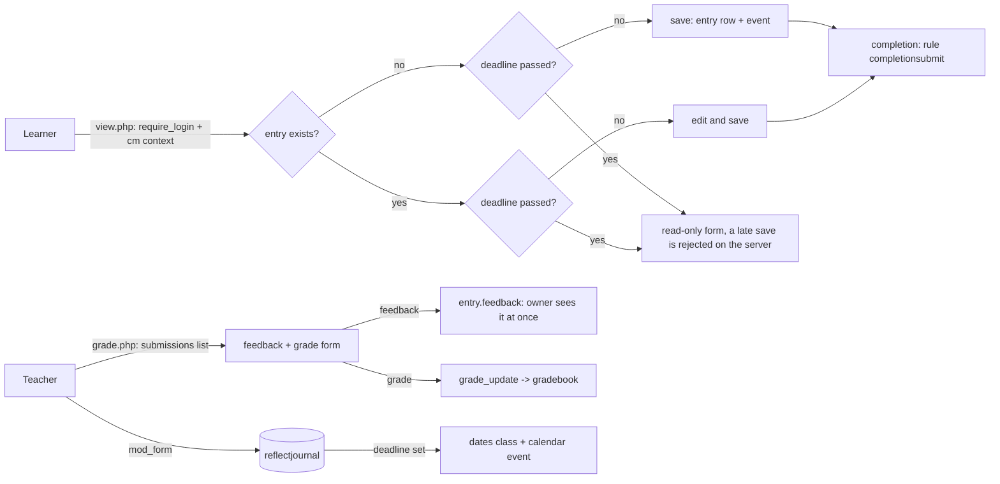

# Reflection Journal: Architecture

Status: **approved** (2026-11-24, after round 3).

Design principle: **use Moodle core, never reinvent**. Each mechanism names the core
API used, cited by file and function name. Source of truth, pinned once for this
document: Moodle `MOODLE_503_STABLE`, commit `1156a935ba4` ("weekly release 5.3.1+",
24 commits after tag `v5.3.1`), read on 2026-11-24. Line-level evidence for the tables
lives in `docs/research.md`. Doc links are the Moodle 5.3 pages on moodledev.io
(checked 2026-11-23 and 2026-11-24). Reference reading: activity-module guide
<https://moodledev.io/docs/5.3/apis/plugintypes/mod>.

## Component and folder layout

Repo root **is** the plugin (`mod_reflectjournal`, Frankenstyle `mod/reflectjournal`),
mounted at `moodle/public/mod/reflectjournal` in dev (ADR-0004).

```
/                          # plugin root = repo root
├── version.php            # $plugin: version, requires Moodle 2026100500 (5.3)
├── lib.php                # *_add/_update/_delete_instance, *_supports, grade, calendar, reset, pluginfile callbacks
├── index.php              # course instances list; triggers course_module_instance_list_viewed
├── view.php               # learner/teacher view (cm id → require_login → render); course_module_viewed
├── grade.php              # submissions list + feedback/grade form
├── mod_form.php           # mod_reflectjournal_mod_form extends moodleform_mod
├── classes/
│   ├── completion/custom_completion.php   # extends core_completion\activity_custom_completion
│   ├── dates.php                        # extends core\activity_dates (course-page dates)
│   ├── event/              # entry_submitted, entry_updated, feedback_added,
│   │                       # course_module_viewed, course_module_instance_list_viewed
│   ├── external/           # FUTURE: web service (core_external API)
│   ├── form/               # feedback + grade form (moodleform subclass)
│   ├── output/             # renderer.php (\mod_reflectjournal\output\renderer) + renderables
│   ├── table/              # submissions_table.php (extends \core_table\sql_table)
│   ├── privacy/provider.php   # metadata, export, delete, user list
│   ├── entry.php           # entry persistence/queries (single source of DML)
│   └── files.php           # pluginfile access decisions, kept apart from send_stored_file()
├── db/
│   ├── install.xml         # XMLDB tables (below); each new field also goes to upgrade.php
│   ├── access.php          # capabilities (matrix below)
│   ├── upgrade.php         # savepointed schema/capability migrations
│   ├── messages.php        # NICE-TO-HAVE: Message API provider
│   ├── hooks.php           # FUTURE: Hooks API registrations
│   └── services.php        # FUTURE: external function declarations
├── lang/en/reflectjournal.php
├── backup/                 # moodle2 backup_* + restore_* task/step classes
├── templates/*.mustache
├── tests/
│   ├── generator/lib.php                                  # PHPUnit: reflectjournal_generator
│   ├── generator/behat_mod_reflectjournal_generator.php   # Behat generator
│   └── behat/                                             # Gherkin features
└── pix/monologo.svg        # activity icon (see the table below)
```

Business logic lives in namespaced `classes/` (autoloaded); `lib.php` stays a thin
bridge (core convention). No `locallib.php` unless a hot path needs it. Module
callbacks are plain functions that core looks up **by name**: reset calls
`reflectjournal_reset_userdata()` only `if (function_exists(...))`
(`reset_course_userdata()` in `lib/moodlelib.php`), and the calendar refresh does the
same for `<mod>_refresh_events` (`course_module_calendar_event_update_process()` in
`course/lib.php`). A misspelled callback is therefore
never called, and nothing complains.

Where each kind of file goes in 5.3 follows core's newer modules. The evidence — counts
of core modules and the core code that resolves each — is in `docs/research.md`,
§Where each kind of file goes in 5.3.

| File | Location in this plugin | Why |
|---|---|---|
| Renderer | `classes/output/renderer.php`, class `\mod_reflectjournal\output\renderer` | Autoloaded; core looks for this class before the legacy root `renderer.php` |
| Forms | `mod_form.php` at the root (required); every other `moodleform` subclass in `classes/form/` | The Form API's own example; five core activity modules do the same |
| Tables | `classes/table/`, extending `\core_table\sql_table` | Where core subsystems keep table classes |
| Test generators | `tests/generator/lib.php` (PHPUnit) and `tests/generator/behat_mod_reflectjournal_generator.php` (Behat) | The two locations core's generators look in |
| Icon | `pix/monologo.svg` | Every core activity module ships one; `icon.svg` is the legacy fallback |
| File access | `classes/files.php`, called by `reflectjournal_pluginfile()` in `lib.php` | Keeps the access decision testable, because `send_stored_file()` ends the request |

The repository has `pix/icon.svg` today; it needs to become `pix/monologo.svg`.

## Core-API mapping (the "use core" ledger)

| Concern | Core mechanism (checked against 5.3 source) | Docs | Notes |
|---|---|---|---|
| Forms | `moodleform_mod` (`course/moodleform_mod.php`): `standard_intro_elements()`, `standard_grading_coursemodule_elements()`, `add_completion_rules()` + `completion_rule_enabled()` | [Form](https://moodledev.io/docs/5.3/apis/subsystems/form) | No custom form framework: `mod_form.php` plus one form in `classes/form/` |
| Rich text & attachments | File API: draft file areas, `file_prepare_draft_area()`, `file_save_draft_area_files()`, `reflectjournal_pluginfile()` in lib.php, `send_stored_file()` (`lib/filelib.php`) | [Files](https://moodledev.io/docs/5.3/apis/subsystems/files), [files in forms](https://moodledev.io/docs/5.3/apis/subsystems/form/usage/files) | Areas `intro`, `entry`, `feedback`. The entry and feedback editors run with `'maxfiles' => 0` until M8, so no file manager is shown. When files arrive, `file_rewrite_pluginfile_urls()` runs before `format_text()`, as `format_module_intro()` does. See §File access |
| Data access | `$DB` (DML) + XMLDB (`db/install.xml`) | [DML](https://moodledev.io/docs/5.3/apis/core/dml), [DDL](https://moodledev.io/docs/5.3/apis/core/dml/ddl) | No tables outside XMLDB; no raw SQL with user input (the one JOIN, in the submissions list, is assembled from core helpers). Keys are documentation only and nothing cascades (§Data model). Entries reach `$DB` only through `classes/entry.php`; `\core\persistent` was evaluated and not adopted (§Data model) |
| Access | Capabilities in `db/access.php`; `require_login()`, `require_capability()` | [Access](https://moodledev.io/docs/5.3/apis/subsystems/access) | Matrix below |
| CSRF | `require_sesskey()` / `confirm_sesskey()` on every write | | |
| Params | `required_param()` / `optional_param()` with `PARAM_*` | | Never `$_GET`/`$_POST` |
| Time | `\core\clock` through `\core\di::get(\core\clock::class)->time()`, never `time()` in plugin code (`clock::time()` in `lib/classes/clock.php`) | [Clock](https://moodledev.io/docs/5.3/apis/core/clock) | Tests freeze it with `mock_clock_with_frozen()` (`advanced_testcase::mock_clock_with_frozen()` in `lib/phpunit/classes/advanced_testcase.php`) |
| Who counts as a learner | `get_enrolled_sql($context, 'mod/reflectjournal:submit', 0, true)` (`lib/enrollib.php`): the enrolled-user id query the submissions list is built on | | The last `true` is `$onlyactive`, so suspended, not-yet-started and ended enrolments are left out (`get_enrolled_join()` in the same file). Suspended learners are a v1 decision: §Known limitations. No group filtering in v1 |
| Deadline on the course page | `mod_reflectjournal\dates extends \core\activity_dates`, `get_dates()` (`lib/classes/activity_dates.php`; core finds the class by this name) | | Returns nothing when `deadline` is 0 |
| Deadline in the calendar | `calendar_event::create()` / `calendar_event::load()` (`calendar/event.php`), as `mod/assign` and `mod/lesson` do, kept current by `reflectjournal_refresh_events()`. Callbacks in `lib.php`: `mod_reflectjournal_core_calendar_provide_event_action()` and `mod_reflectjournal_core_calendar_event_timestart_updated()` (`mod_lesson_core_calendar_provide_event_action()`, `mod_lesson_core_calendar_event_timestart_updated()` and `lesson_refresh_events()` in `mod/lesson/lib.php`) | [Calendar](https://moodledev.io/docs/5.3/apis/core/calendar) | Created, updated and deleted with the instance. Without the action callback the event is not shown on the dashboard (`apply_component_provide_event_action()` in `calendar/classes/local/event/container.php`); without the timestart callback it cannot be dragged (`calendar_edit_event_allowed()` in `calendar/lib.php`). Core also calls `refresh_events()` after a course reset and after a restore (§Backup/restore scope) |
| Grading | The gradebook is the only store: `grade_update()` (`lib/gradelib.php`) + module callbacks | [Advanced grading, not v1](https://moodledev.io/docs/5.3/apis/core/grading) | [ADR-0007](adr/0007-gradebook-is-the-only-grade-store.md); see §Grading integration |
| Completion | `classes/completion/custom_completion.php` extends `\core_completion\activity_custom_completion` (`get_state()`); rule `completionsubmit`; state refreshed with `\completion_info::update_state()` | [Completion](https://moodledev.io/docs/5.3/apis/core/activitycompletion) | `FEATURE_COMPLETION_HAS_RULES`. Core reads the rule through `reflectjournal_get_coursemodule_info()` (`assign_get_coursemodule_info()` in `mod/assign/lib.php`). `FEATURE_GRADE_HAS_GRADE` also switches on core's "Require grade" condition, and because `FEATURE_COMPLETION_TRACKS_VIEWS` is not declared there is no "view" condition (`add_completion_elements()` in `completion/classes/form/form_trait.php`), so `view.php` does not call `set_module_viewed()` |
| Output | `\mod_reflectjournal\output\renderer` in `classes/output/renderer.php`, extends `\plugin_renderer_base`; renderables in `classes/output/`, Mustache templates | [Output](https://moodledev.io/docs/5.3/apis/subsystems/output) | No inline HTML in PHP. Classes get the renderer through `\core\output\renderer_helper`, not the `$PAGE`/`$OUTPUT` globals (class docblock of `core\output\renderer_helper` in `lib/classes/output/renderer_helper.php`) |
| Output cleaning | Every stored text — prompt, entry, feedback — is printed through `format_text($text, $format, ['context' => $context])` (`lib/weblib.php`). Never `noclean`, never `['clean' => false]`. In Mustache, `{{{ }}}` only for HTML that `format_text()` returned; everything else `{{ }}` | [Output](https://moodledev.io/docs/5.3/apis/subsystems/output), [Templates](https://moodledev.io/docs/5.3/guides/templates) | The editor element stores its text uncleaned: it sets types only for `[format]` and `[itemid]` (`MoodleQuickForm_editor::onQuickFormEvent()` in `lib/form/editor.php`). So output is where content is purified; tests save `<script>` in each of the three (§Tests this design needs) |
| Submissions list | `\core_table\sql_table` (`lib/table/classes/sql_table.php`): `set_sql($fields, $from, $where, $params)` over `get_enrolled_sql()` as a derived table, `LEFT JOIN {reflectjournal_entries}` on `userid` and the instance id | | Core paging and sorting; a learner with no entry still gets a row |
| Logging | Events API: `classes/event/*`, including `course_module_viewed` and `course_module_instance_list_viewed`, which extend the core events (the abstract classes `core\event\course_module_viewed` and `core\event\course_module_instance_list_viewed` in `lib/classes/event/`). They are triggered in `view.php` and `index.php` before any output, with `add_record_snapshot()` (`assign::set_module_viewed()` in `mod/assign/locallib.php`); the standard log store picks them up | | No legacy `db/log.php` |
| Notifications (nice-to-have) | Message API: provider in `db/messages.php`, `message_send(\core\message\message)` | [Message](https://moodledev.io/docs/5.3/apis/core/message) | Not scheduled |
| Privacy | `classes/privacy/provider.php`: metadata, export, delete, and the userlist provider (`get_users_in_context()`, `delete_data_for_users()`) | [Privacy](https://moodledev.io/docs/5.3/apis/subsystems/privacy) | Feeds Moodle's data request tools; every plugin provider must also implement the userlist provider. `feedbackby` makes the teacher a data subject too: [ADR-0008](adr/0008-feedbackby-privacy-semantics.md) |
| Backup/restore | `backup/moodle2/` task and step classes, restore counterparts | [Backup](https://moodledev.io/docs/5.3/apis/subsystems/backup), [Restore](https://moodledev.io/docs/5.3/apis/subsystems/backup/restore) | User data behind a setting. `FEATURE_BACKUP_MOODLE2` is what lets core load these classes (file-level code in `backup/moodle2/backup_plan_builder.class.php`); core backs up and restores the activity's grades itself (`backup_activity_task::build()` in `backup/moodle2/backup_activity_task.class.php`) |
| Course reset | `reflectjournal_reset_course_form_definition(&$mform)`, `reflectjournal_reset_course_form_defaults()` and `reflectjournal_reset_userdata($data)` in `lib.php`, found by name (`course_reset_form::definition()` and `course_reset_form::load_defaults()` in `course/reset_form.php`; `reset_course_userdata()` in `lib/moodlelib.php`) | | Deletes entries and their files itself and returns a status array. Grades follow the gradebook's reset options, applied in `reset_course_userdata()` (`lib/moodlelib.php`). See §Course reset |
| Strings | `lang/en/reflectjournal.php` + `get_string()` | | English only; AMOS after release |
| Features | `reflectjournal_supports()`: six features, each with its effect in the next table | | No group mode in v1. `FEATURE_GROUPMEMBERSONLY` must never be passed: `plugin_supports()` throws on it (`lib/moodlelib.php`) |

Anything not on this ledger must justify itself in an ADR before being written custom.

## Features declared by `reflectjournal_supports()`

| Feature | Value | What core does with it |
|---|---|---|
| `FEATURE_MOD_INTRO` | `true` | Adds the "Description" field to the settings form (core assumes `true` anyway) |
| `FEATURE_GRADE_HAS_GRADE` | `true` | Sets core's `hasgrades` flag, which drives the "Grade" settings, and switches on the "Require grade" completion condition |
| `FEATURE_COMPLETION_HAS_RULES` | `true` | Marks the module as having custom completion rules (`moodleform_mod::add_completion_rules()`) |
| `FEATURE_BACKUP_MOODLE2` | `true` | Lets core load the `backup/moodle2/backup_reflectjournal_*` classes; restore and the recycle bin check it too |
| `FEATURE_SHOW_DESCRIPTION` | `true` | Adds the "Show description on course page" checkbox. The flag lives on the course module, so no instance column is needed |
| `FEATURE_MOD_PURPOSE` | `MOD_PURPOSE_ASSESSMENT` (accepted 2026-11-24) | Tells core what the activity is for, as `mod_assign` does; core assumes `MOD_PURPOSE_OTHER` when it is missing |

Deliberately not declared: `FEATURE_COMPLETION_TRACKS_VIEWS` (accepted 2026-11-24, so
there is no "view" completion rule), `FEATURE_CONTROLS_GRADE_VISIBILITY` (the gradebook
owns hiding: `grade_item::can_control_visibility()` in `lib/grade/grade_item.php`), and
the group features. The core code behind each row is listed in `docs/research.md`,
§Features declared.

## Data model (db/install.xml)

```
reflectjournal            (one per course module instance)
  id, course, name, intro, introformat, timemodified
  deadline (int; 0 = no deadline)                          [M2]
  grade (int; 0 = none, > 0 = max points, < 0 = scale id)  [M4]
  completionsubmit (int; 1 = "entry submitted" rule on)      [with the rule]

reflectjournal_entries    (one row per learner per instance)
  id, reflectjournalid → reflectjournal.id (index; no FK constraint)
  userid → user.id
  content, contentformat
  timecreated (= submission time; there is no draft state), timemodified
  feedback, feedbackformat, feedbackby, feedbackmodified   [M4]
  UNIQUE KEY (reflectjournalid, userid)   ← enforces "one entry"
  INDEX userid                              ← privacy export and delete by user

Grades are not stored here. They live in the gradebook (§Grading integration).
```

M0 ships `reflectjournal` (standard fields only); `deadline`, `grade`,
`completionsubmit`, and the whole `entries` table arrive via `db/upgrade.php` with
`upgrade_mod_savepoint()` — which the CI "check upgrade savepoints" step then proves.

**Two places for every schema change.** A new field or table goes into `db/install.xml`
**and** into `db/upgrade.php` behind a savepoint, with `version.php` bumped, so that a
fresh install and an upgrade end at the same schema. That holds for everything above.

**`completionsubmit`** is an int of length 2, not null, default 0, as in the
`completionsubmit` field of `mod/assign/db/install.xml`. Core never reads the column
directly: `reflectjournal_get_coursemodule_info()` publishes it as
`customdata['customcompletionrules']['completionsubmit']`
(`assign_get_coursemodule_info()` in `mod/assign/lib.php`), and
`classes/completion/custom_completion.php::get_state()` turns "entry row exists" into a
completion state (`custom_completion::get_state()` in
`mod/assign/classes/completion/custom_completion.php`).

**Keys are documentation; nothing cascades.** Moodle creates no foreign key
constraints: every driver leaves `sql_generator::$foreign_keys` at `false`
(`lib/ddl/sql_generator.php`), so a `KEY TYPE="foreign"` becomes a plain index when the
table is created (`sql_generator::getCreateTableSQL()`; the code's own comment, "we
aren't going to enable referential integrity", is in `sql_generator::getDropKeySQL()`).
A `UNIQUE KEY` is still enforced, because the same function creates it as a unique
index. Consequences:

- Child rows are deleted **explicitly** in three places:
  `reflectjournal_delete_instance()` (entry rows, then the instance row), the privacy
  provider's two delete methods, and `reflectjournal_reset_userdata()`. Files differ
  per case. Deleting the activity needs no file code: core removes every file in the
  module context, the calendar events, the grade items and the completion data right
  after `_delete_instance()` returns (`core_courseformat\local\cmactions::delete()` in
  `course/format/classes/local/cmactions.php`). Privacy deletion and course reset keep
  the context, so they delete files themselves.
- Two saves racing for one learner can both pass the "entry exists?" check. The save
  path relies on the unique index: `try { $DB->insert_record(...) } catch
  (dml_write_exception $e) { re-read; if the row still does not exist, rethrow; else
  update it }`. The exception class is `dml_write_exception` (`lib/dmllib.php`); the
  idiom is the one core uses for duplicate adhoc tasks
  (`\core\task\manager::queue_adhoc_task()` in `lib/classes/task/manager.php`) and for
  concurrent first-access records (`user_accesstime_log()` in `lib/datalib.php`).
- **The save path never runs inside a delegated transaction.** On PostgreSQL a failed
  INSERT puts the whole transaction into an aborted state, so the re-read would fail as
  well (PostgreSQL manual, §Transactions: "a transaction block that was put in aborted
  state by the system due to an error"). `entry::save()` starts with
  `$DB->transactions_forbidden()` (`lib/dml/moodle_database.php`), which throws
  `dml_transaction_exception` if a transaction is open.
- **The race test is deterministic.** `\mod_reflectjournal\entry::find_existing()` is
  the only place the save path asks whether a row exists. The page obtains `entry`
  from `\core\di`, so the test swaps in a subclass whose `find_existing()` inserts the
  competing row before answering, on its first call only. The interleaving is forced,
  not timed. The test runs in CI on both databases, PostgreSQL and MariaDB
  (ADR-0005).

**`\core\persistent` was evaluated for the entry row and not adopted.** It would bring
typed properties and automatic timestamps, but `create()` always writes a
`usermodified` column this table does not have (`persistent::properties_definition()`
and `persistent::create()` in `lib/classes/persistent.php`), and it covers none of the
rules above. In the 5.3 source only 3 of the 38 classes extending it are in activity
modules (core knowledge graph, 2026-11-24). Revisit if a second table appears.

## Capability matrix

Capabilities are defined in `db/access.php`. Contexts and role defaults follow core's
own modules (`mod/assign`, `mod/forum`). Role defaults apply on install only; changing
them later needs an upgrade step.

| Capability | Type / risk | Context | Default roles | Guards |
|---|---|---|---|---|
| `mod/reflectjournal:addinstance` | write / RISK_XSS | Course | editingteacher, manager | Adding or editing the activity (rich-text prompt); clones `moodle/course:manageactivities` |
| `mod/reflectjournal:view` | read | Module | student, teacher, editingteacher, manager | Opening the activity; reading the prompt and the user's **own** entry and feedback |
| `mod/reflectjournal:submit` | write | Module | student | Creating and editing the user's **own** entry until the deadline |
| `mod/reflectjournal:givefeedback` | write / RISK_XSS | Module | teacher, editingteacher, manager | Reading **any** learner's entry; opening `grade.php` (the submissions list and the grading page); saving feedback |
| `mod/reflectjournal:grade` | write / RISK_XSS | Module | teacher, editingteacher, manager | Only the grade field on the grading page and its save action. It opens no page of its own: `grade.php` requires `givefeedback` |

Tests must cover (M3):
- An entry and its feedback are readable only by their owner or by a user with
  `givefeedback`.
- Ownership is checked separately from the capability: `submit` never allows editing
  another user's entry.
- A teacher without `grade` can open `grade.php` and save feedback, but cannot save a
  grade; a user without `givefeedback` cannot open `grade.php` at all.
- Core capabilities are used unchanged: `moodle/grade:edit` still governs the gradebook.

## Grading integration

Grades live only in the gradebook ([ADR-0007](adr/0007-gradebook-is-the-only-grade-store.md)).
The plugin has no grade column and no grade table; it writes through with
`grade_update()` (`lib/gradelib.php`) plus the module callbacks core looks up by name.

**Setup**
- The instance's `grade` column: `0` none, `> 0` maximum points, `< 0` scale id. Chosen
  in the settings form with `moodleform_mod::standard_grading_coursemodule_elements()`.
- Declared with `reflectjournal_supports(FEATURE_GRADE_HAS_GRADE)`.

**Module callbacks in lib.php**

| Callback | Called by | Purpose |
|---|---|---|
| `reflectjournal_grade_item_update($instance, $grades = null)` | Our add/update instance; core's `grade_update_mod_grades()` | Create or update the grade item from `grade`; `'reset'` clears every grade (course reset), as `quiz_grade_item_update()` in `mod/quiz/lib.php` does |
| `reflectjournal_update_grades($instance, $userid = 0)` | Same | The required partner of the function above. It only makes sure the grade item exists and pushes nothing, because the plugin holds no grades (ADR-0007) |
| `reflectjournal_grade_item_delete($instance)` | Our `reflectjournal_delete_instance()`, as core modules do (`quiz_grade_item_delete()` in `mod/quiz/lib.php`) | Remove the grade item with `['deleted' => 1]`. Core would remove it anyway right after `_delete_instance()` returns; calling it keeps the module self-contained |
| `reflectjournal_rescale_activity_grades($course, $cm, $oldmin, $oldmax, $newmin, $newmax)` | Core, when a teacher changes the maximum grade and confirms the rescale (see "Rescaling under ADR-0007" below) | Rescale the grades stored in the gradebook; return `true`, or core aborts the save |

The first two must exist together: core calls them as a pair and reports a developer
warning if only one does (`grade_update_mod_grades()` in `lib/gradelib.php`). The
rescale option appears in the settings form only when the fourth callback exists
(`course/moodleform_mod.php`).

**Rescaling under ADR-0007 (no local grades).** What core does when the callback
exists: the settings form gains a "Rescale existing grades" choice and refuses to save
a changed maximum grade until the teacher answers it (`MoodleQuickForm_modgrade` in
`lib/form/modgrade.php`; `moodleform_mod::init_features()` in
`course/moodleform_mod.php` sets `canrescale` from `component_callback_exists()`). On
save, `update_moduleinfo()` in `course/modlib.php` calls our
`reflectjournal_update_instance()` first and then the callback with the old and the new
minimum and maximum, only when both grade types are points. Unless the callback returns
`true`, core throws `cannotreprocessgrades`; `component_callback()` in
`lib/moodlelib.php` passes a `null` return through as `null`, so returning nothing fails
too. What ours does: no plugin data is involved. It loads the activity's grade item
(`grade_item::fetch()`) and calls `grade_item::rescale_grades_keep_percentage()`, the
helper the gradebook itself uses when a teacher edits an item's maximum
(`grade/edit/tree/item.php`). The helper rescales every grade stored for that item so
that percentages stay the same, and returns `false` when the range cannot be scaled.
`mod_assign` cannot work this way, because it keeps its own grade table:
`assign_rescale_activity_grades()` rescales that table and pushes again. That is the
alternative ADR-0007 rejects.

**Writing a grade.** `grade.php` itself requires `givefeedback`. The grade field and its
save action additionally require `mod/reflectjournal:grade` and `require_sesskey()`:

    $result = grade_update('mod/reflectjournal', $course->id, 'mod', 'reflectjournal', $instance->id, 0, $grades, $itemdetails);

`$grades` is one grade or several, each with `userid` and `rawgrade` (`null` = not graded)
(`lib/gradelib.php`). Only a user id is needed, so a learner with no entry can be
graded. The return value is checked on every write (`lib/grade/constants.php`):

| Result | Meaning | What the plugin does |
|---|---|---|
| `GRADE_UPDATE_OK` | Saved | Nothing further |
| `GRADE_UPDATE_ITEM_LOCKED` | The grade item is locked in the gradebook (`lib/gradelib.php`) | Tells the teacher to unlock it there; does not retry |
| `GRADE_UPDATE_FAILED` | The learner's grade is locked or past its lock time, or the item takes no raw grades (`grade_item::update_raw_grade()` in `lib/grade/grade_item.php`) | Tells the teacher the grade was not saved |
| `GRADE_UPDATE_MULTIPLE` | More than one grade item matches (`lib/gradelib.php`) | A bug: raises a coding exception |

**Reading the current grade.** The form's default comes from the gradebook:
`grade_item::fetch()` for this activity's item, then `get_grade($userid, false)` —
`false` so that merely looking does not insert an empty grade row
(`lib/grade/grade_item.php`). Not `grade_get_grades()`: its docblock warns it can
trigger a full course regrade (`lib/gradelib.php`).

**Grades edited in the Grader report.** A grade changed there is marked overridden. The
grading form shows it read-only with a note, because while it is overridden core keeps
the final grade and the gradebook's own feedback (`grade_item::update_raw_grade()`
in `lib/grade/grade_item.php`).

**What a learner sees.** The activity shows learners their own grade, read the same way
as the form's default (`grade_item::fetch()`, then `get_grade($userid, false)`), and
only while `grade_grade::is_hidden()` returns `false` (`lib/grade/grade_grade.php`).
`is_hidden()` covers both hide levels: a grade hidden for that learner in the Grader
report, and the item's "Hidden" or "Hidden until". This is the cheap, read-only path.
`grade_get_grades()` is not used because its docblock warns it can trigger a full course
regrade (`grade_get_grades()` in `lib/gradelib.php`). The course-level "Show gradebook
to students" setting (`showgrades`) is not consulted, because no core activity consults
it before displaying a grade inside the activity — the only `mod/` use is lesson's
"View grades" link on its end-of-lesson page (`display_eol_page()` in
`mod/lesson/renderer.php`; evidence in `docs/research.md`). Tests cover both hide levels
(§Tests this design needs).

**Visibility.** The gradebook owns it; the plugin keeps no flag and has no release
mechanism. Two core settings apply: the grade item's "Hidden"/"Hidden until", and hiding
a single learner's grade in the Grader report. `grade_grade::is_hidden()` returns true
for either, so any grade shown inside the activity must go through it. Feedback is not a
grade and is never hidden this way. `FEATURE_CONTROLS_GRADE_VISIBILITY` is deliberately
not declared (`grade_item::can_control_visibility()` in `lib/grade/grade_item.php`),
and the plugin never passes `hidden` in `$itemdetails`, although `grade_update()`
accepts it (`lib/gradelib.php`).

**Feedback is not copied into the gradebook.** `grade_update()` could carry `feedback`
and `feedbackformat` with each grade (`lib/gradelib.php`), but feedback is visible as
soon as it is saved (PRD L3) while grades follow the gradebook's hidden setting. One
store cannot serve both rules and two copies would drift, so the gradebook's
"Feedback" column stays empty for this activity.

**Not in v1**: advanced grading methods (rubrics, checklists), outcomes, a second grade item.

## How the PRD decisions are implemented

| Decision (`docs/prd.md`) | Mechanism |
|---|---|
| Optional deadline; none means always open | `deadline = 0`: no lock, no calendar event, no dates |
| Entries lock at the deadline | The save handler checks the deadline itself on every write: when `deadline` is set, a request at or after it is rejected with an error and nothing is stored. The read-only form is only the UI for the same rule. The check reads `\core\di::get(\core\clock::class)->time()`, so the test freezes the clock one second before the deadline and exactly on it (`advanced_testcase::mock_clock_with_frozen()` in `lib/phpunit/classes/advanced_testcase.php`). Feedback and grading are unaffected |
| No draft state | No status column. An entry row exists means submitted; `timecreated` is the submission time |
| Completion, once earned, stays | The rule is "entry row exists", and v1 has no delete-entry action, so it cannot regress |
| Feedback private and immediate | Stored on the entry row, shown only to its owner or `givefeedback` holders; no release flag |
| Grade visibility is the gradebook's | §Grading integration, ADR-0007 |
| Grading a learner with no entry | The submissions list comes from enrolled users, not from entry rows; `grade_update()` addresses a grade by user id (`grade_update()` in `lib/gradelib.php`) |
| Suspended learners are not in the submissions list | `get_enrolled_sql()` is called with `$onlyactive = true`; a suspended learner's existing entry stays stored but leaves the list with them (§Known limitations) |
| Learners see their own grade inside the activity | §Grading integration, "What a learner sees" |

## Known limitations (v1)

- **Suspended learners are not in the submissions list**, whether or not they have an
  entry (accepted 2026-11-24). Their rows are not deleted: the entry stays stored, is
  exported and deleted by privacy requests, and still satisfies completion. This matches
  core's participants list, which shows active users only unless the viewer holds both
  `moodle/course:enrolreview` and `moodle/course:viewsuspendedusers`
  (`user/classes/table/participants_search.php`). A "show suspended" filter, gated on
  **both** `moodle/course:enrolreview` and `moodle/course:viewsuspendedusers`
  (ruled 2026-11-24), is nice-to-have for a later version.
- **No delete-entry action**, for anyone (accepted 2026-11-24). This is what keeps
  "completion once earned, stays" true.

## Request flow



## File access (`pluginfile()`)

`pluginfile.php` ends in `file_pluginfile()` (`lib/filelib.php`). For an activity module
core serves the `intro` area itself, after `require_course_login()`, and then calls
`mod_reflectjournal_pluginfile()` in `lib.php` for every other area; that callback "must
send the file and terminate. Whatever it returns leads to not found".

`mod_reflectjournal_pluginfile()` is a thin wrapper. It hands the request to
`\mod_reflectjournal\files::resolve()`, which does the checks and either returns the
`stored_file` or throws; the wrapper then calls `send_stored_file()`. The split exists
because `send_stored_file()` ends the request, so the access decision has to be callable
without it to be testable. The chain, in order:

1. The context is a module context; otherwise not found.
2. `require_login($course, false, $cm)`.
3. `require_capability('mod/reflectjournal:view', $context)`.
4. Per area, with the entry id taken from the URL:
   - `entry` and `feedback`: load the entry; it must belong to this instance. The
     request is allowed for the entry's owner, and for anyone else only with
     `mod/reflectjournal:givefeedback`.
   - Any other area: not found.
5. Fetch the file by its full path; a directory counts as not found.

The pattern follows `assignsubmission_file_pluginfile()` in
`mod/assign/submission/file/lib.php`: login first, then the record must belong to this
instance, then owner-or-capability, then the file.

Until M8 only the prompt's `intro` area holds files. The entry and feedback editors run
with `'maxfiles' => 0` (the editor's own default), so they show no file manager and no
draft area is prepared (`MoodleQuickForm_editor::toHtml()` in `lib/form/editor.php`).
The callback and its tests are built now, so that M8 adds two areas and no new access
path. From M8 the stored text carries `@@PLUGINFILE@@` placeholders, and every output
runs `file_rewrite_pluginfile_urls()` before `format_text()`, as `format_module_intro()`
does (`lib/weblib.php`).

## Privacy provider scope

Stores: `reflectjournal_entries` (content, files in the `entry` file area; feedback).
`get_metadata()` declares that table with both user-id fields, `userid` and
**`feedbackby`** (`'userid' => 'privacy:metadata:userid'`; `feedbackby` gets the same
treatment or its own `privacy:metadata:*` string, as `mod/assign` gives its `grader`
column — `provider::get_metadata()` in `mod/assign/classes/privacy/provider.php`),
plus the file areas.

The provider implements three interfaces (`provider` in
`mod/h5pactivity/classes/privacy/provider.php` is the model):

- `\core_privacy\local\metadata\provider` — `get_metadata()`.
- `\core_privacy\local\request\plugin\provider` — `get_contexts_for_userid()`,
  `export_user_data()`, `delete_data_for_all_users_in_context()`,
  `delete_data_for_user()` (the interface `core_user_data_provider` in
  `privacy/classes/local/request/core_user_data_provider.php`).
- `\core_privacy\local\request\core_userlist_provider` — `get_users_in_context()`,
  `delete_data_for_users()` (the interface `core_userlist_provider` in
  `privacy/classes/local/request/core_userlist_provider.php`). Mandatory for every
  plugin provider; 14 of the 23 core activity modules implement it.

**`feedbackby` is the teacher's personal data.** The provider treats the teacher who
wrote feedback as a data subject in their own right, the way `mod_assign` treats a
grader: contexts and user lists include `feedbackby`, a teacher's export lists the
feedback they wrote, and a teacher's erasure request deletes that feedback —
`feedback`, `feedbackformat`, `feedbackmodified` and the files in the `feedback` area,
with `feedbackby` set to 0 — while leaving the learner's entry and the gradebook grade
untouched. Reasoning and test:
[ADR-0008](adr/0008-feedbackby-privacy-semantics.md).

That is what lets Moodle's data request tools cover the plugin's data (PRD L4), for one
user or for many users in a context at once. Export groups by instance; the two delete
methods remove rows and files explicitly (keys do not cascade, §Data model). Grades
belong to the gradebook and are covered by its own provider
(`grade/classes/privacy/provider.php`).

## Backup/restore scope

Backup: instance config always; entries and feedback only when "user data" is
toggled. Every file area is annotated so its files travel too: `annotate_files()` for
`intro`, `entry` and `feedback` (`backup_nested_element::annotate_files()` in
`backup/util/structure/backup_nested_element.class.php`).

Restore:

- `apply_date_offset($data->deadline)` moves the deadline when the course start date
  moves; an empty (0) deadline stays 0 (`restore_step::apply_date_offset()` in
  `backup/util/plan/restore_step.class.php`; used the same way in
  `restore_assign_activity_structure_step::process_assign()` in
  `mod/assign/backup/moodle2/restore_assign_stepslib.php`).
- `userid` and `feedbackby` are remapped with `get_mappingid('user', …)`
  (`restore_structure_step::get_mappingid()` in
  `backup/util/plan/restore_structure_step.class.php`; used as in
  `restore_assign_activity_structure_step::process_assign_submission()` in
  `mod/assign/backup/moodle2/restore_assign_stepslib.php`). A user who is not
  restored maps to `false`, which is stored as 0.
- Files come back with `add_related_files()` (`restore_structure_step::add_related_files()`
  in `backup/util/plan/restore_structure_step.class.php`).
- Gradebook history is restored by core (`restore_gradebook_structure_step` and
  `restore_grade_history_structure_step` in `backup/moodle2/restore_stepslib.php`).
- The deadline event is an action event (it has the action callback), and restore does
  not copy action events (`restore_calendarevents_structure_step::process_calendarevents()`
  in `backup/moodle2/restore_stepslib.php`). Instead it queues
  `\core\task\refresh_mod_calendar_events_task`
  (`restore_calendar_action_events::define_execution()`, added by
  `restore_final_task::build()` in `backup/moodle2/restore_final_task.class.php`).
  That task calls `reflectjournal_refresh_events()`
  (`refresh_mod_calendar_events_task::execute()` in
  `lib/classes/task/refresh_mod_calendar_events_task.php`, which runs
  `course_module_calendar_event_update_process()` from `course/lib.php`). This is
  why the hook must rebuild the event from `deadline`.

## Course reset

Core looks up three optional functions in `lib.php`, by name
(`course_reset_form::definition()` and `course_reset_form::load_defaults()` in
`course/reset_form.php`; `reset_course_userdata()` in `lib/moodlelib.php`):

| Function | Job |
|---|---|
| `reflectjournal_reset_course_form_definition(&$mform)` | Add a header and one checkbox ("Delete all entries and feedback") to the reset form |
| `reflectjournal_reset_course_form_defaults($course)` | Defaults for that checkbox |
| `reflectjournal_reset_userdata($data)` | Runs only when the course has instances. Delete entries and their files, and return an array of status lines |

- It **must return an array**. Without the function core reports "reset not implemented"
  for the module (`reset_course_userdata()` in `lib/moodlelib.php`).
- **Grades.** When the course-wide "Delete all grades" is ticked, core runs
  `grade_course_reset()` itself, inside `reset_course_userdata()`
  (`lib/moodlelib.php`). Otherwise the module clears its own item when its
  entries are deleted —
  `reflectjournal_grade_item_update($instance, 'reset')` — as `mod_lesson` and `mod_quiz`
  do (`lesson_reset_userdata()` in `mod/lesson/lib.php`; `quiz_reset_gradebook()`
  in `mod/quiz/lib.php`).
- **Dates.** When the reset shifts the course start date, `deadline` moves with it:
  `shift_course_mod_dates('reflectjournal', ['deadline'], $data->timeshift, $data->courseid)`
  (`lesson_reset_userdata()` in `mod/lesson/lib.php`).
- Core refreshes every module's calendar events right after its reset function
  (`reset_course_userdata()` in `lib/moodlelib.php`).

## Tests this design needs

| For | Test |
|---|---|
| Output cleaning | PHPUnit and Behat: save `<script>alert(1)</script>` as the prompt, as an entry and as feedback, then assert that no `<script>` reaches any rendered page |
| Deadline enforced on the server | PHPUnit with a frozen clock: a save one second before the deadline succeeds, a save exactly at the deadline is rejected and writes nothing, and a request built without the form is rejected the same way |
| One entry under a race | PHPUnit: swap in the `entry` subclass whose `find_existing()` creates the competing row, and assert the save ends with exactly one row and no exception. It runs in CI on both databases, PostgreSQL and MariaDB (ADR-0005) |
| Transaction guard | PHPUnit: call `entry::save()` inside `$DB->start_delegated_transaction()` and assert `dml_transaction_exception` |
| Hidden grades stay hidden | PHPUnit, once per hide level (the learner's grade hidden in the Grader report; the item "Hidden until" a future date): the learner's page shows no grade. With both removed it shows the grade |
| File access across learners | PHPUnit: learner B asks `files::resolve()` for a file in learner A's `entry` area and gets `required_capability_exception`; A gets the file; a teacher with `givefeedback` gets it; an entry id from another instance is not found |
| Capability split | PHPUnit: a teacher without `mod/reflectjournal:grade` opens `grade.php` and saves feedback but is refused on the grade field; a user without `givefeedback` cannot open the page |
| Feedback erasure for a teacher | PHPUnit (ADR-0008): after a delete request for teacher T, the feedback T wrote is gone (text, format, timestamp, `feedback` file area) and `feedbackby` is 0, while the learner's entry and grade are unchanged |
| Rescale keeps percentages | PHPUnit: learners graded across the range, then `reflectjournal_rescale_activity_grades()` with a new maximum — every learner's percentage is unchanged and no plugin data is touched |
| `grade_update` locked results | PHPUnit: with the grade item locked, `grade_update()` returns `GRADE_UPDATE_ITEM_LOCKED` and the page tells the teacher to unlock it there; with the learner's grade locked or past its lock time, it returns `GRADE_UPDATE_FAILED` and the page says the grade was not saved |
| Backup/restore round trip | PHPUnit: backup with user data, restore into a second course — entries, feedback (text and `feedbackby` remapped), the `entry` and `feedback` files, and the deadline shifted by the date offset come back; without user data, no entries arrive |
| Privacy provider | PHPUnit extending core's `\core_privacy\tests\provider_testcase`: metadata, learner export/erasure and teacher export/erasure run through the core test case (ADR-0008) |
| Calendar event create/refresh | PHPUnit: saving an instance with a deadline creates the action event; changing the deadline updates its time; `reflectjournal_refresh_events()` rebuilds it from `deadline` (the restore path); removing the deadline removes it |
| Completion rule | PHPUnit: `completionsubmit` on and an entry row exists → complete via `\completion_info::update_state()`; no entry → incomplete; the state never regresses (no delete-entry action) |

## Conventions

- **Capabilities have language strings.** Every capability in `db/access.php` needs a
  string keyed `<plugin>:<capability>` in `lang/en/reflectjournal.php`, for example
  `$string['reflectjournal:grade']`. Core looks that key up when it names a capability
  (`get_capability_string()` in `lib/accesslib.php`), and the Access API guide shows
  the same rule (`$string['folder:managefiles']`).
- **Templates start with a docblock.** Every Mustache file begins with the GPL header
  and a comment naming it, `{{! @template mod_reflectjournal/<name> }}`, plus the
  context variables it expects. The Templates guide lists this boilerplate and the rule
  that raw `{{{ }}}` output must have been through `format_text()`.
- **`version.php` states maturity and release.** `$plugin->maturity` is declared (it is
  `MATURITY_ALPHA` today; `MATURITY_STABLE` at the v1 release) and `$plugin->release`
  is added, a human-readable version name (ruled 2026-11-24: the `release` line goes
  into the M0 baseline PR, not a docs change). The 5.3 `version.php` guide marks both
  "Recommended"; core reads `release` in `base::load_disk_version()`
  (`lib/classes/plugininfo/base.php`) and compares `maturity` when it checks for updates
  (`plugin_manager::available_updates()` in `lib/classes/plugin_manager.php`).

## Future (explicitly not v1)

- **External web service**: `db/services.php` + `classes/external/` using the namespaced
  external API (`\core_external\external_api`, `external_value`,
  `external_single_structure`, `external_multiple_structure`, `external_function_parameters`
  in `lib/external/classes/`). The old global names (`\external_api`, `\external_value`,
  …) are deprecated in 5.3 — MDL-81225, listed under core_external → Deprecated in
  `UPGRADING.md` — and still resolve through the `$renamedclasses` map in
  `lib/db/renamedclasses.php`. The helper functions left in `lib/externallib.php`
  have been deprecated since 4.4 (MDL-76583; `\core_external\util` replaces them).
  AJAX endpoints same route. The web service must not call the save path inside a
  transaction: the duplicate-key recovery needs to catch the failed INSERT, and on
  PostgreSQL that puts the transaction into an aborted state (§Data model).
- **Hooks API**: `db/hooks.php` registering callbacks (PSR-14, array notation).
  Docs: <https://moodledev.io/docs/5.3/apis/core/hooks>. Candidate: react to core hooks
  rather than adding lib.php callbacks for anything new.
- **Moodle app support**: `db/mobile.php` + app templates once v1 is stable.
