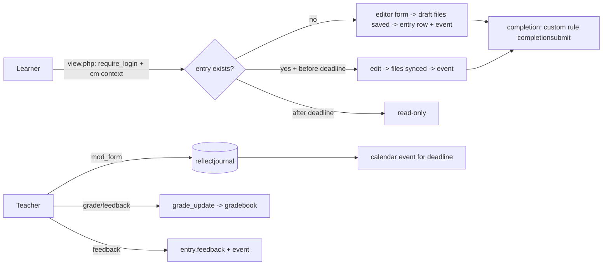

# Reflection Journal: Architecture

Design principle: **use Moodle core, never reinvent**. Each mechanism names the core
API used. Per-API doc URLs: the index at <https://moodledev.io/docs/apis/> is verified
live; the site is mid-migration so some per-API pages 404 (see `docs/research.md`) —
re-link exact pages when implementing. Reference reading: activity-module guide
<https://moodledev.io/docs/apis/plugintypes/mod>.

## Component and folder layout

Repo root **is** the plugin (`mod_reflectjournal`, Frankenstyle `mod/reflectjournal`),
mounted at `moodle/public/mod/reflectjournal` in dev (ADR-0004).

```
/                          # plugin root = repo root
├── version.php            # $plugin: version, requires Moodle 2026100500 (5.3)
├── lib.php                # *_add/_update/_delete_instance, *_supports, grade callbacks
├── index.php              # course instances list
├── view.php               # entry point (cm id → require_login → render)
├── mod_form.php           # mod_reflectjournal_mod_form extends moodleform_mod
├── classes/
│   ├── completion/custom_completion.php   # core_completion custom rules API
│   ├── event/              # entry_submitted, entry_updated, feedback_added
│   ├── external/           # FUTURE: web service (core_external API)
│   ├── output/             # renderables (entry_view, entries_table)
│   ├── privacy/provider.php
│   └── entry.php           # entry persistence/queries (single source of DML)
├── db/
│   ├── install.xml         # XMLDB tables (below)
│   ├── access.php          # capabilities
│   ├── upgrade.php         # savepointed schema/capability migrations
│   ├── hooks.php           # FUTURE: Hooks API registrations
│   └── services.php        # FUTURE: external function declarations
├── lang/en/reflectjournal.php
├── backup/                 # moodle2 backup_* + restore_* task/step classes
├── templates/*.mustache
├── tests/                  # PHPUnit + Behat (tests/behat/)
└── pix/icon.svg
```

Business logic lives in namespaced `classes/` (autoloaded); `lib.php` stays a thin
bridge (core convention). No `locallib.php` unless a hot path needs it.

## Core-API mapping (the "use core" ledger)

| Concern | Core mechanism | Notes |
|---|---|---|
| Forms | `moodleform` / `moodleform_mod` (`mod_form.php`), `formslib` editor+filemanager elements | One class, no custom form framework |
| Rich text & attachments | File API: draft fileareas, `file_save_draft_area_files()`, `pluginfile()` in lib.php, `send_stored_file()` | Areas: `intro`, `entry`, `feedback`; attachment UI lands in M8 (last feature milestone) |
| Data access | `$DB` (DML) + XMLDB (`db/install.xml`) via XMLDB editor | No custom tables outside XMLDB; no raw SQL |
| Access | Capabilities in `db/access.php`, `require_login()`, `require_capability()` | Contexts: COURSE (addinstance), MODULE (rest) |
| CSRF | `require_sesskey()` / `confirm_sesskey()` on every write | |
| Params | `required_param()` / `optional_param()` with `PARAM_*` | Never `$_GET/$_POST` |
| Deadlines | `deadline` column + core calendar event (`calendar_event::create` in add/update) + activity dates for course page | Verify dates-API callback name during M2 |
| Grading | Gradebook: `reflectjournal_grade_item_update()` / `reflectjournal_update_grades()` lib callbacks + `grade_update()`; `FEATURE_GRADE_HAS_GRADE` | No custom grade table |
| Completion | `classes/completion/custom_completion.php`; `FEATURE_COMPLETION_HAS_RULES`; rule `completionsubmit` | |
| Output | plugin `renderer.php` extends `plugin_renderer_base`, outputables in `classes/output/`, Mustache templates | No inline HTML in PHP |
| Logging | Events API: `classes/event/*` extends `base`; standard log store picks them up | No legacy `db/log.php` |
| Privacy | `classes/privacy/provider.php` (`core_privacy\local\metadata\provider` + `mod_plugin_provider`): metadata, export, delete | |
| Backup/restore | `backup/moodle2/backup_reflectjournal_activity_task.class.php` + structure step + restore counterparts | Userdata (entries) behind a setting |
| Strings | `lang/en/reflectjournal.php` + `get_string()` | English only; AMOS after release |
| Features | `reflectjournal_supports()` (FEATURE_MOD_INTRO, FEATURE_GRADE_HAS_GRADE, FEATURE_COMPLETION_HAS_RULES, …) | No deprecated flags (FEATURE_GROUPMEMBERSONLY out); **no group mode** — v1 is individual only (see PRD out-of-scope) |

Anything not on this ledger must justify itself in an ADR before being written custom.

## Data model (db/install.xml)

```
reflectjournal            (one per course module instance)
  id, course, name, intro, introformat, timemodified
  deadline (int, 0 = none)           [M2]
  grade (int, 0 = none; negative = scale id)   [M4]

reflectjournal_entries    (one row per learner per instance)
  id, reflectjournalid → reflectjournal.id (FK cascade)
  userid → user.id
  content, contentformat
  timemodified, submitted? (inferred from timemodified — decide in M2)
  feedback, feedbackformat, feedbackby, feedbacktimemodified   [M4]
  UNIQUE KEY (reflectjournalid, userid)   ← enforces "one entry"
```

M0 ships `reflectjournal` (standard fields only); `deadline`, `grade`, and the whole
`entries` table arrive via `db/upgrade.php` with `upgrade_mod_savepoint()` — which the
CI "check upgrade savepoints" step then proves.

## Capabilities (db/access.php)

| Capability | Context | Roles (default) |
|---|---|---|
| `mod/reflectjournal:addinstance` | COURSE | manager, editingteacher |
| `mod/reflectjournal:view` | MODULE | student..manager |
| `mod/reflectjournal:submit` | MODULE | student |
| `mod/reflectjournal:givefeedback` | MODULE | editingteacher, teacher, manager |

## Request flow



## Privacy provider scope

Stores: `reflectjournal_entries` (content, files in `entry` filearea; feedback).
Provider declares these + user mapping; export groups by instance; delete removes
rows + files. Nothing else holds personal data (logs are core's business).

## Backup/restore scope

Backup: instance config always; entries/feedback only when "user data" toggled.
Restore: maps reflectjournal + user ids; gradebook history handled by core restore.

## Future (explicitly not v1)

- **External web service**: `db/services.php` + `classes/external/` using the current
  external API (`core_external` namespaced classes — `\external_*` deprecated in 5.3,
  MDL-81225). AJAX endpoints same route.
- **Hooks API**: `db/hooks.php` registering callbacks (PSR-14, array notation).
  Docs: <https://moodledev.io/docs/apis/core/hooks>. Candidate: react to core hooks
  rather than adding lib.php callbacks for anything new.
- **Moodle app support**: `db/mobile.php` + app templates once v1 is stable.
